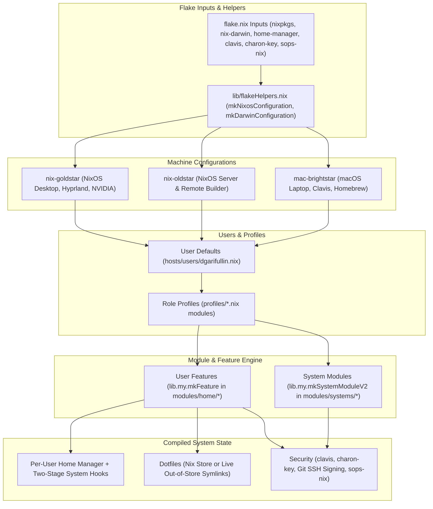

# Nix Configuration (`dot`)

[](https://nixos.org/)
[](https://github.com/LnL7/nix-darwin)
[](LICENSE)
[](https://github.com/GDR/dot/actions)

Personal NixOS & nix-darwin configuration built on a typed, per-user feature compiler (`mkFeature`), role-based profiles, and cross-platform system modules (`mkSystemModuleV2`).

---

## Features

- **Multi-platform** — Unified flake architecture across NixOS (`x86_64-linux`) and macOS (`aarch64-darwin`).
- **Isolated per-user features (`mkFeature`)** — Home Manager configuration compiles strictly per enabled user, with optional two-stage system activation (`nixosModule` / `darwinModule`) and transitive `requires` resolution.
- **Hierarchical enables & composable profiles** — Enable whole categories (`home.browsers.enable = true`), individual features (`home.browsers.vivaldi.enable = true`), or compose native role modules (`profiles/*.nix`).
- **Dual-mode dotfiles** — Switch seamlessly between immutable `/nix/store` generation-safe symlinks and out-of-store live editing (`dotfiles.live` / `<feature>.dotfilesLive`).
- **Hardware-backed SSH & zero-drift auth** — macOS Keychain/Touch ID SSH & `age` agent (`clavis`), Git SSH commit signing, dynamic GitHub `AuthorizedKeysCommand` (`charon-key`), and `sops-nix` + Bitwarden secret workflows.
- **Auto-discovery** — Drop a `.nix` file under `modules/home/` or `modules/systems/{all,linux,darwin}/` and it is registered automatically.

---

## Table of Contents

- [Quick Start](#quick-start)
- [Architecture](#architecture)
  - [Architecture Diagram](#architecture-diagram)
  - [Directory Structure](#directory-structure)
  - [Module Types](#module-types)
- [Guides](#guides)
  - [Create a New Host](#create-a-new-host)
  - [Create a New User](#create-a-new-user)
  - [Profiles & Hierarchical Enables](#profiles--hierarchical-enables)
  - [Create a New Module](#create-a-new-module)
  - [Dotfile Symlink Modes](#dotfile-symlink-modes)
- [Security & Secrets Management](#security--secrets-management)
- [Host Configuration](#host-configuration)
- [Module Reference](#module-reference)
- [License](#license)

---

## Quick Start

```bash
# Clone repository
git clone https://github.com/gdr/dot.git ~/Workspaces/gdr/dot
cd ~/Workspaces/gdr/dot

# Apply on NixOS:
sudo nixos-rebuild switch --flake .#<hostname>

# Apply on macOS (nix-darwin):
darwin-rebuild switch --flake .#<hostname>
```

---

## Architecture

### Architecture Diagram



### Directory Structure

```text
dot/
├── flake.nix                 # Entry point — inputs, overlays, host outputs, checks
├── docs/                     # Architecture & operational documentation
│   ├── security-architecture.md
│   └── security-runbook.md
├── hosts/
│   ├── users/                # Shared user defaults (dgarifullin.nix)
│   └── machines/             # Per-host configurations
│       ├── nix-goldstar/     # NixOS desktop (Hyprland, NVIDIA)
│       ├── nix-oldstar/      # NixOS server & remote builder
│       └── mac-brightstar/   # macOS workstation (nix-darwin)
├── lib/
│   ├── default.nix           # Core library namespace (lib.my.*)
│   ├── features.nix          # mkFeature compiler, option tree builder, dotfiles compiler
│   ├── flakeHelpers.nix      # mkNixosConfiguration, mkDarwinConfiguration
│   ├── moduleRegistry.nix    # Auto-discovery & transitive dependency resolver
│   └── themes/               # Color themes (rose-pine-moon, catppuccin-macchiato, etc.)
├── profiles/                 # Composable role bundles (developer, desktop, gaming, server, macos)
├── modules/
│   ├── _core/                # Core infrastructure (registry.nix, user.nix, system.nix, theme.nix)
│   ├── home/                 # Auto-discovered user features (mkFeature)
│   │   ├── ai-tools/         # claude, codex, gemini-cli, learnharness
│   │   ├── browsers/         # chromium, vivaldi
│   │   ├── cli/              # gcloud, htop, shell-utils, vault
│   │   ├── desktop/          # appearance, awesomewm, hyprland, services, utils, widgets
│   │   ├── downloads/        # qbittorrent
│   │   ├── editors/          # antigravity, cursor, ghidra, neovim, vscode-server
│   │   ├── games/            # lutris, soundpad, steam
│   │   ├── media/            # iina, spotify, vlc
│   │   ├── messengers/       # telegram
│   │   ├── security/         # bitwarden, clavis, keepassxc
│   │   ├── shell/            # git, ssh, tmux, zsh
│   │   ├── terminal/         # ghostty
│   │   ├── utils/            # logseq, macfuse, obsidian, raycast
│   │   └── virtualisation/   # docker, virtualbox
│   └── systems/              # Auto-discovered system modules (mkSystemModuleV2)
│       ├── all/              # fonts, sops, nix/{gc,settings}, shell/ssh
│       ├── linux/            # graphics, keyboards, networking, power-management, sound
│       └── darwin/           # homebrew, macos-settings, openssh
├── overlays/                 # Nixpkgs overlays & patches
├── pkgs/                     # Custom package derivations
└── templates/                # Project flake templates (python, tex)
```

### Module Types

| Type | Location | Constructor | Enabled via | Scope |
|------|----------|-------------|-------------|-------|
| **User Feature** | `modules/home/` | `lib.my.mkFeature` | `hostUsers.<user>.modules.home.<path>.enable` (or global `modules.home.<path>.enable`) | Per-user Home Manager + optional system hooks (`nixosModule` / `darwinModule`) |
| **System (All)** | `modules/systems/all/` | `lib.my.mkSystemModuleV2` | `modules.system.all.<name>.enable` (or `modules.system.all.enable`) | System-wide, cross-platform |
| **System (Linux)** | `modules/systems/linux/` | `lib.my.mkSystemModuleV2` | `modules.system.linux.<name>.enable` (or `modules.system.linux.enable`) | System-wide, NixOS only |
| **System (Darwin)** | `modules/systems/darwin/` | `lib.my.mkSystemModuleV2` | `modules.system.darwin.<name>.enable` (or `modules.system.darwin.enable`) | System-wide, macOS only |

---

## Guides

### Create a New Host

1. **Create the host directory and generate hardware config (NixOS):**

```bash
mkdir -p hosts/machines/my-new-host
nixos-generate-config --show-hardware-config > hosts/machines/my-new-host/hardware-configuration.nix
```

2. **Create `hosts/machines/my-new-host/default.nix`:**

```nix
{ ... }:
{
  imports = [
    ./hardware-configuration.nix
    ../../../profiles/developer.nix
    ../../../profiles/desktop.nix
  ];

  system.stateVersion = "26.05";
  networking.hostName = "my-new-host";
  environment.variables.DOTFILES_DIR = "/home/dgarifullin/Workspaces/gdr/dot";

  hostUsers.dgarifullin = {
    imports = [ ../../users/dgarifullin.nix ];
    enable = true;
    keys = [{
      name = "my-new-host";
      type = "ed25519";
      purpose = [ "git" "ssh" ];
      isDefault = true;
    }];
    ssh = [
      {
        host = "*";
        identityFile = "~/.ssh/my-new-host_id_ed25519";
        extraOptions.AddKeysToAgent = "yes";
      }
      {
        host = "github.com";
        user = "git";
        identityFile = "~/.ssh/my-new-host_id_ed25519";
      }
    ];

    modules = {
      home.desktop.hyprland.enable = true;
      home.browsers.vivaldi.enable = true;
    };
  };

  modules.system.all = {
    fonts.enable = true;
    sops.enable = true;
  };

  modules.system.linux.networking.openssh = {
    enable = true;
    userMap = { "dgarifullin" = "gdr"; };
  };

  time.timeZone = "Europe/Moscow";
  theme.name = "rose-pine-moon";
}
```

3. **Register in `flake.nix`:**

```nix
nixosConfigurations.my-new-host = flakeHelpers.mkNixosConfiguration ./hosts/machines/my-new-host;
# or for macOS:
darwinConfigurations.my-new-host = flakeHelpers.mkDarwinConfiguration ./hosts/machines/my-new-host;
```

---

### Create a New User

1. **Define shared user defaults in `hosts/users/newuser.nix`:**

```nix
{ lib, ... }:
{
  fullName = lib.mkDefault "New User";
  email = lib.mkDefault "newuser@example.com";
  github = lib.mkDefault "newuser";
  extraGroups = [ "wheel" "audio" ];
  uid = lib.mkDefault 1001;
}
```

2. **Enable the user on a host:**

```nix
{
  hostUsers.newuser = {
    imports = [ ../../users/newuser.nix ];
    enable = true;
    modules = {
      home.cli.enable = true;
      home.shell.enable = true;
      home.editors.neovim.enable = true;
    };
  };
}
```

---

### Profiles & Hierarchical Enables

Role profiles in [`profiles/`](profiles) are NixOS/nix-darwin modules setting `profileModules.home.*` and `modules.system.{all,linux,darwin}.*` with `lib.mkDefault`:

| Profile | Included Modules |
|---------|------------------|
| `developer.nix` | `home.{cli,editors,shell,terminal}`, `home.virtualisation.docker`, `system.all.{nix.settings,nix.gc,shell.ssh}` |
| `desktop.nix` | `home.{browsers,downloads,media,messengers,security,utils}`, `home.desktop.{appearance,services,utils,widgets}`, `system.linux.{sound,networking}` |
| `gaming.nix` | `home.games` |
| `server.nix` | `home.{cli,shell}`, `home.editors.neovim`, `home.virtualisation.docker`, `system.linux.networking.{openssh,tailscale,firewall}` |
| `macos.nix` | `system.darwin.macos-settings` |

Import multiple profiles in `imports = [ ... ];` and override cleanly via normal NixOS module priority:

```nix
{
  imports = [
    ../../../profiles/developer.nix
    ../../../profiles/desktop.nix
  ];

  hostUsers.dgarifullin = {
    inheritProfiles = true;
    modules = {
      home.utils.enable = false;          # Disable category
      home.utils.obsidian.enable = true;  # Selective opt-in wins over parent false
    };
  };
}
```

**Resolution rules (`lib.my.isFeatureEnabledForUser`):**
- Most specific path wins (`home.utils.obsidian.enable = true` overrides `home.utils.enable = false`).
- Per-user settings (`hostUsers.<user>.modules.*`) override global defaults (`modules.*`).
- Enabling a feature automatically enables its transitive `requires` graph per user (unless explicitly opted out with `enable = false`).

---

### Create a New Module

#### User Feature (`mkFeature`)

Create a file under `modules/home/<category>/<name>.nix` — it is auto-discovered and typed options are generated automatically:

```nix
# modules/home/cli/my-tool.nix
{ lib, ... }:

lib.my.mkFeature {
  description = "My CLI tool";
  platforms = [ "linux" "darwin" ];
  requires = [ "home.shell.zsh" ];

  extraOptions = {
    defaultFormat = lib.mkOption {
      type = lib.types.str;
      default = "json";
      description = "Default output format";
    };
  };

  dotfiles = {
    path = "my-tool";
    source = "modules/home/cli/my-tool/dotfiles";
  };

  homeModule = { pkgs, featureCfg, ... }: {
    home.packages = [ pkgs.my-tool ];
    home.sessionVariables.MY_TOOL_FORMAT = featureCfg.defaultFormat;
  };

  homeModuleLinux = { ... }: { };
  homeModuleDarwin = { ... }: { };
  nixosModule = { selectedUsers, ... }: { };
  darwinModule = { selectedUsers, ... }: { };
}
```

#### System Module (`mkSystemModuleV2`)

Create a file under `modules/systems/{all,linux,darwin}/`:

```nix
# modules/systems/linux/networking/my-daemon.nix
{ lib, pkgs, ... }@args:

lib.my.mkSystemModuleV2 args {
  namespace = "linux"; # "all" | "linux" | "darwin"
  description = "My Linux system daemon";

  extraOptions = {
    port = lib.mkOption {
      type = lib.types.port;
      default = 9000;
      description = "Listening port";
    };
  };

  module = cfg: {
    services.my-daemon = {
      enable = true;
      port = cfg.port;
    };
  };
}
```

---

### Dotfile Symlink Modes

Features declaring `dotfiles = { path; source; target?; live?; }` support two symlink modes:

1. **Store Mode (`live = false`, default):** Copies dotfiles into `/nix/store`. Store paths are bound to NixOS / Home Manager generations so rollbacks restore exact historical configs.
2. **Live Mode (`live = true`):** Creates out-of-store symlinks directly into `$DOTFILES_DIR` (or `~/dot` fallback) via `mkOutOfStoreSymlink`. Edits take effect immediately without rebuilding.

Configure globally, per feature definition, or per host/user override (most specific wins):

```nix
# Global host toggle:
dotfiles.live = true;

# Per-feature override (global or under hostUsers.<user>.modules):
modules.home.terminal.ghostty.dotfilesLive = true;
modules.home.desktop.hyprland.dotfilesLive = false;
```

---

## Security & Secrets Management

Full architectural details and operational commands live in:
- **[Security Architecture](docs/security-architecture.md)** — `clavis` Keychain/Touch ID SSH agent, static vs. dynamic Git SSH commit signing, `charon-key` GitHub `AuthorizedKeysCommand`, and `sops-nix`.
- **[Security & Key Management Runbook](docs/security-runbook.md)** — Day-to-day commands for provisioning keys, verifying `sshd` / `charon-key`, and managing SOPS secrets.

Summary of key conventions:
- **Outbound SSH & Git Signing**: `gpg.format = "ssh"` everywhere. macOS uses `clavis` (`~/.ssh/clavis.sock`) with dynamic key resolution (`ssh-add -L | head -1`); Linux uses per-host keys declared in `hostUsers.<user>.keys` (`~/.ssh/<name>_id_<type>`) or `home.security.bitwarden.sshAgent`.
- **Inbound SSH (`charon-key`)**: `modules.system.{linux.networking,darwin}.openssh.userMap` maps local users to GitHub usernames via `AuthorizedKeysCommand`.
- **Secrets (`sops-nix` + `age`)**:
  - Linux `SOPS_AGE_KEY_FILE`: `~/.config/sops/age/keys.txt` (XDG default).
  - macOS `SOPS_AGE_KEY_FILE`: `$HOME/Library/Application Support/sops/age/keys.txt` (exported by `modules.system.all.sops.enable = true`).
  - Interactive Zsh `sops()` wrapper (`modules/home/shell/zsh/dotfiles/common.zsh`) fetches `bw get notes "SOPS Age Key <hostname>"` from Bitwarden CLI and caches it (`0600`) in `${XDG_RUNTIME_DIR:-${TMPDIR%/}}` for 15 minutes.

---

## Host Configuration

| Host | Platform | Description |
|------|----------|-------------|
| `nix-goldstar` | NixOS (`x86_64-linux`) | Desktop workstation — Hyprland, NVIDIA, gaming, remote builder |
| `nix-oldstar` | NixOS (`x86_64-linux`) | Homelab server & remote builder (ThinkPad T480) |
| `mac-brightstar` | nix-darwin (`aarch64-darwin`) | MacBook workstation — `clavis`, `nix-homebrew`, distributed Linux builds |

---

## Module Reference

### User Features (`modules/home/`)

| Category | Modules |
|----------|---------|
| `home.ai-tools` | `claude`, `codex`, `gemini-cli`, `learnharness` |
| `home.browsers` | `chromium`, `vivaldi` |
| `home.cli` | `gcloud`, `htop`, `shell-utils` (bat, fzf, fastfetch, wget, direnv), `vault` |
| `home.desktop` | `appearance.cursor`, `awesomewm`, `hyprland`, `services.{audio,brightness,notifications}`, `utils.{nautilus,wayland}`, `widgets.{launcher,network-applet,omarchy-waybar,tailscale-systray,waybar}` |
| `home.downloads` | `qbittorrent` |
| `home.editors` | `antigravity`, `cursor`, `ghidra`, `neovim` (`nvim.nix`), `vscode-server` |
| `home.games` | `lutris`, `soundpad`, `steam` |
| `home.media` | `iina` (darwin), `spotify`, `vlc` |
| `home.messengers` | `telegram` |
| `home.security` | `bitwarden`, `clavis` (darwin), `keepassxc` |
| `home.shell` | `git`, `ssh`, `tmux`, `zsh` |
| `home.terminal` | `ghostty` |
| `home.utils` | `logseq`, `macfuse` (darwin), `obsidian`, `raycast` (darwin) |
| `home.virtualisation` | `docker`, `virtualbox` |

### System Modules (`modules/systems/`)

| Namespace | Modules |
|-----------|---------|
| `modules.system.all` | `fonts`, `nix.gc`, `nix.settings`, `shell.ssh`, `sops` |
| `modules.system.linux` | `graphics.{amd,intel,nvidia}`, `keyboards.keychron`, `networking.{firewall,networkmanager,openssh,tailscale}`, `power-management`, `sound` |
| `modules.system.darwin` | `homebrew`, `macos-settings`, `openssh`, `ssh` |

---

## License

MIT License — see [LICENSE](LICENSE) for details.
