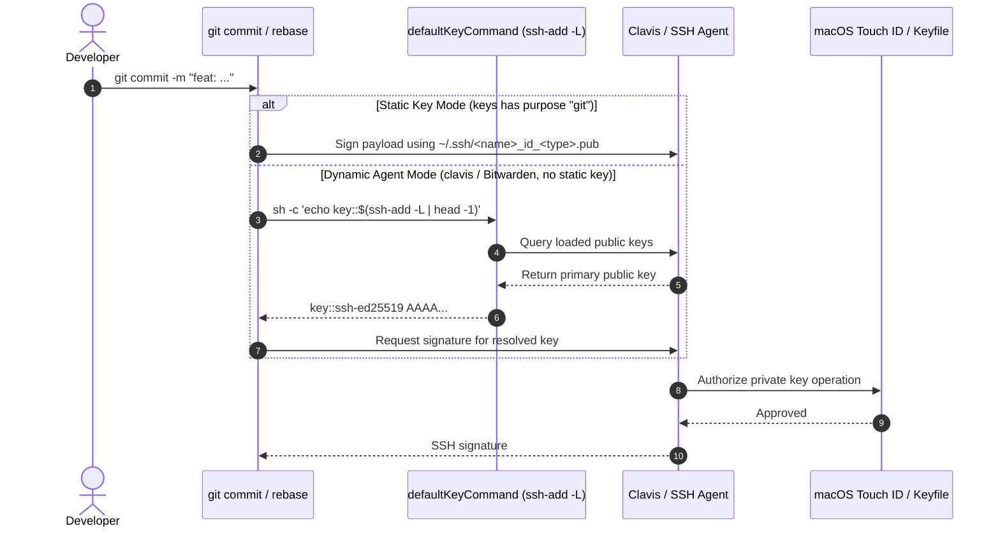
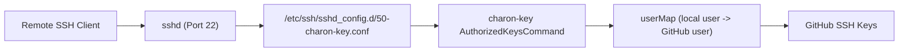

# Security Architecture

Comprehensive reference for SSH authentication, Git SSH commit signing, dynamic inbound authorization, and secret management across NixOS (`nix-goldstar`, `nix-oldstar`) and macOS (`mac-brightstar`) hosts in `GDR/dot`.

---

## System Overview

Security across the fleet is structured around three decoupled subsystems:

1. **Outbound SSH & Git Signing** — Hardware-backed `clavis` Keychain/Touch ID agent on macOS, per-host SSH keys (or Bitwarden SSH Agent) on Linux, and universal SSH commit signing (`gpg.format = "ssh"`).
2. **Inbound SSH Authorization** — Zero-drift GitHub public key resolution via `charon-key` (`AuthorizedKeysCommand`) on both NixOS and nix-darwin.
3. **Secret Management** — `sops-nix` + `age` encryption backed by OS-native key paths and an interactive Zsh wrapper that fetches per-host keys from Bitwarden CLI with a 15-minute runtime cache.

```mermaid
flowchart TD
    subgraph Outbound ["Outbound Auth & Git Signing"]
        Git["Git CLI (gpg.format = ssh)"]
        SSHClient["OpenSSH Client (~/.ssh/config)"]
        Clavis["macOS: clavis-agent (~/.ssh/clavis.sock)"]
        LinuxAgent["Linux: ssh-agent / Bitwarden SSH Agent"]
        HostKeys["Linux: Per-Host Keys (~/.ssh/<name>_id_<type>)"]
    end

    subgraph Inbound ["Inbound SSH Authorization"]
        SSHD["OpenSSH Daemon (sshd)"]
        Charon["charon-key AuthorizedKeysCommand"]
        GitHubKeys["GitHub Public Keys (userMap)"]
    end

    subgraph Secrets ["Secret Management"]
        SopsNix["sops-nix / sops CLI"]
        AgeFile["SOPS_AGE_KEY_FILE (age keys.txt)"]
        ZshWrapper["Zsh sops() Wrapper (15m Runtime Cache)"]
        BitwardenVault["Bitwarden CLI (SOPS Age Key <host>)"]
    end

    Git --> SSHClient
    Git --> Clavis
    Git --> LinuxAgent
    SSHClient --> Clavis
    SSHClient --> LinuxAgent
    LinuxAgent --> HostKeys

    SSHD --> Charon
    Charon --> GitHubKeys

    SopsNix --> AgeFile
    ZshWrapper --> BitwardenVault
    ZshWrapper --> SopsNix
```

---

## 1. Outbound SSH & Agent Architecture

### Platform Agents

| Platform / Mode | Module | Agent / Backing Store | Socket Path |
| :--- | :--- | :--- | :--- |
| **macOS (Primary)** | [`modules/home/security/clavis.nix`](../modules/home/security/clavis.nix) | `clavis-agent --daemon` via `launchd` (`com.clavis.agent`), macOS Keychain + Touch ID | `~/.ssh/clavis.sock` |
| **Linux (Default)** | [`modules/systems/all/shell/ssh.nix`](../modules/systems/all/shell/ssh.nix) | System `ssh-agent` (`programs.ssh.startAgent = true`) + per-host `IdentityFile` | `$SSH_AUTH_SOCK` (system default) |
| **Bitwarden (Optional)** | [`modules/home/shell/ssh/ssh.nix`](../modules/home/shell/ssh/ssh.nix) | Bitwarden Desktop SSH Agent (`hostUsers.<user>.modules.home.security.bitwarden.sshAgent.enable = true`) | macOS: `~/Library/Containers/com.bitwarden.desktop/Data/.bitwarden-ssh-agent.sock` / Linux: `~/.bitwarden/ssh-agent.sock` |

### Per-User SSH Client Wiring (`modules/home/shell/ssh/ssh.nix`)

User SSH client settings are compiled per user from `osConfig.hostUsers.<user>`:

- **Agent Precedence**:
  1. **Clavis** (macOS only — guarded by `isDarwin` so `home.security.enable = true` on Linux never activates it): active when `home.security.clavis` is enabled for the user (optional custom socket via `modules.home.security.clavis.socketPath`).
  2. **Bitwarden SSH Agent**: active when `home.security.bitwarden` is enabled and `modules.home.security.bitwarden.sshAgent.enable = true`.
  3. **Standard `ssh-agent` + Static Keys**: fallback when neither external agent is enabled.
- **`~/.ssh/config` Generation**:
  - When an external agent (`clavis` or Bitwarden) is active: sets `IdentityAgent` to the resolved socket, `IdentitiesOnly = "no"`, and `AddKeysToAgent = "no"`.
  - When using static per-host keys: sets `IdentitiesOnly = "yes"` and `AddKeysToAgent = "yes"`, wiring `hostUsers.<user>.ssh` match blocks (such as `identityFile = "~/.ssh/goldstar_id_rsa"` or `"~/.ssh/oldstar_id_ed25519"`).
  - Forces `AddressFamily = "inet"` for `github.com` to avoid IPv6 timeouts on dual-stack networks.
  - Copies `~/.ssh/config` out of the Nix store symlink with `0600` permissions during Home Manager activation (`fixSshConfigPerms`) so OpenSSH strict permission checks succeed.
- **Environment & Forwarded Agent Safety**:
  - Exports `SSH_AUTH_SOCK` in `home.sessionVariables` and `launchctl setenv SSH_AUTH_SOCK` on macOS so GUI apps and IDEs inherit the socket.
  - Guards Zsh `SSH_AUTH_SOCK` export with `if [ -z "${SSH_CONNECTION-}" ]` so inbound SSH sessions with `ForwardAgent = true` preserve their forwarded agent socket instead of overwriting it locally.
- **Public Key Materialization**:
  - Any entry in `hostUsers.<user>.keys` with a non-null `publicKey` is written to `~/.ssh/<name>_id_<type>.pub`.

---

## 2. Git SSH Commit Signing (`modules/home/shell/git.nix`)

All hosts sign Git commits and tags using **SSH signatures** (`gpg.format = "ssh"`). [`modules/home/shell/git.nix`](../modules/home/shell/git.nix) supports two automatic modes depending on how keys are provisioned on the host:

| Mode | Condition | Git Configuration Produced | Active Hosts |
| :--- | :--- | :--- | :--- |
| **Static Signing Key** | `hostUsers.<user>.keys` has an entry with `"git"` in `purpose` (prefers `isDefault = true`, else first match) | `user.signingkey = ~/.ssh/<name>_id_<type>.pub`, `commit.gpgsign = true`, `gpg.format = "ssh"` | `nix-goldstar`, `nix-oldstar` |
| **Dynamic Agent Key** | No static Git key in `hostUsers.<user>.keys`, and `clavis` or `bitwarden.sshAgent` is active | `gpg.ssh.defaultKeyCommand = "sh -c 'echo key::$(ssh-add -L \| head -1)'"`, `commit.gpgsign = true`, `gpg.format = "ssh"` | `mac-brightstar` |

---

## 3. Inbound SSH Authorization (`charon-key`)

Inbound `sshd` access on both NixOS and nix-darwin delegates public key lookup to [`GDR/charon-key`](https://github.com/GDR/charon-key), eliminating manual `~/.ssh/authorized_keys` synchronization across machines.

- **NixOS ([`modules/systems/linux/networking/openssh.nix`](../modules/systems/linux/networking/openssh.nix))**:
  - Enables `services.openssh.enable = true` with key-only defaults (`PasswordAuthentication = false`, `KbdInteractiveAuthentication = false`, `PermitRootLogin = "no"`).
  - Maps explicit users via `modules.system.linux.networking.openssh.userMap` (`{ "<localUser>" = "<githubUser>"; }`) into `services.charon-key.userMap`.
- **macOS ([`modules/systems/darwin/openssh.nix`](../modules/systems/darwin/openssh.nix))**:
  - Enables `services.openssh.enable = true` with key-only `extraConfig` (`PasswordAuthentication no`, `KbdInteractiveAuthentication no`, `PermitRootLogin no`), and cleans up `/etc/ssh/sshd_config.d/50-charon-key.conf` + `/etc/ssh/charon-key-wrapper` when disabled.
  - Maps `modules.system.darwin.openssh.userMap` into `services.charon-key.userMap` via `charon-key.darwinModules.default`.
  - **Darwin `101-authorized-keys.conf` Override**: `nix-darwin` writes `/etc/ssh/sshd_config.d/101-authorized-keys.conf` (`/bin/cat`), which sorts lexicographically before `charon-key`'s `50-charon-key.conf` (`'1' < '5'`). Because OpenSSH honors only the **first** `AuthorizedKeysCommand` it parses, nix-darwin's default file would shadow `charon-key`. The Darwin module forces `environment.etc."ssh/sshd_config.d/101-authorized-keys.conf".text = lib.mkForce ""` so `50-charon-key.conf` is authoritative.

---

## 4. Secret Management (`sops-nix`, `age`, & Bitwarden)

Encrypted secrets use [`sops-nix`](https://github.com/Mic92/sops-nix) and `age` recipients configured per host.

### System SOPS Configuration (`modules/systems/all/sops.nix`)

Enabling `modules.system.all.sops.enable = true` installs `sops` system-wide and standardizes `SOPS_AGE_KEY_FILE` across platforms:

| Platform | Age Key File Path | Wiring |
| :--- | :--- | :--- |
| **Linux / NixOS** | `~/.config/sops/age/keys.txt` (user) / `/etc/ssh/ssh_host_ed25519_key` (system `sops-nix`) | Native XDG default for `sops` CLI; `sops-nix.nixosModules.sops` imported in `mkNixosConfiguration`. |
| **macOS / Darwin** | `$HOME/Library/Application Support/sops/age/keys.txt` | Explicitly exported via `environment.variables.SOPS_AGE_KEY_FILE` (`/etc/zshenv` + `launchctl`). `clavis` also provides an `age` Keychain/Touch ID plugin. |

### Interactive Zsh `sops` Wrapper (`modules/home/shell/zsh/dotfiles/common.zsh`)

For interactive secret editing without leaving plaintext `age` private keys on disk permanently, [`common.zsh`](../modules/home/shell/zsh/dotfiles/common.zsh) defines a `sops()` shell wrapper:

1. **Per-Host Lookup Key**: Resolves short hostname via `hostname -s` (e.g., `mac-brightstar`, `nix-goldstar`, `nix-oldstar`).
2. **15-Minute Runtime Cache**: Stores the retrieved `age` key with `0600` (`umask 077`) permissions in `${XDG_RUNTIME_DIR:-${TMPDIR%/}}` (per-user runtime directory) with a 900-second TTL.
3. **Automatic Expiration**: Before each `sops` invocation, inspects file `mtime`; if older than 900 seconds, deletes the cache file.
4. **Bitwarden CLI Fallback (Process-Scoped)**: When `SOPS_AGE_KEY` is unset and no valid cache file exists, queries `bw get notes "SOPS Age Key <hostname>"` from an unlocked Bitwarden CLI session, caches it (`0600`), and passes `SOPS_AGE_KEY` strictly to `command sops "$@"` without exporting it into the parent shell.
