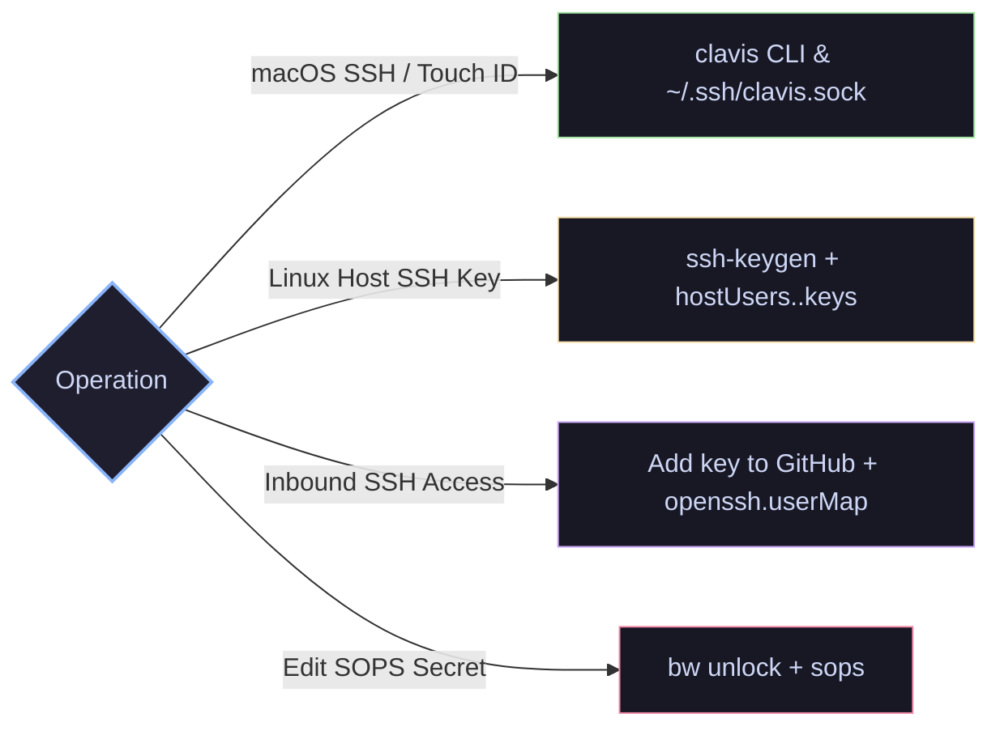

# Security & Key Management Runbook

Operational runbook for managing `clavis`, per-host SSH keys, Git SSH commit signing, `charon-key` inbound SSH authorization, and `sops` + Bitwarden secret workflows in `GDR/dot`.

---

## Quick Reference Workflow



---

## 1. Outbound SSH Keys & Agents

### A. macOS: Clavis Keychain SSH Agent (`mac-brightstar`)

`clavis` stores SSH keys in the macOS Keychain gated by Touch ID and serves them over `~/.ssh/clavis.sock` via `launchd` (`com.clavis.agent`).

1. **Enable in host configuration** ([`hosts/machines/mac-brightstar/default.nix`](../hosts/machines/mac-brightstar/default.nix)):
   ```nix
   hostUsers.dgarifullin = userDefaults.user // {
     enable = true;
     clavisAgent.enable = true;
     modules.home.security.clavis.enable = true;
   };
   ```

2. **Manage keys & inspect agent status**:
   ```bash
   # Inspect clavis CLI commands (generate/import/list Keychain keys)
   clavis --help

   # List public keys currently exposed by clavis-agent
   ssh-add -L

   # Verify SSH_AUTH_SOCK points to ~/.ssh/clavis.sock
   echo "$SSH_AUTH_SOCK"
   ls -la ~/.ssh/clavis.sock

   # Check or restart the launchd agent
   launchctl print "gui/$(id -u)/com.clavis.agent"
   launchctl kickstart -k "gui/$(id -u)/com.clavis.agent"
   ```

3. **Test outbound authentication**:
   ```bash
   ssh -T git@github.com
   ```

---

### B. Linux: Per-Host SSH Keys (`nix-goldstar`, `nix-oldstar`)

Linux hosts declare per-machine SSH keys in `hostUsers.<user>.keys` and match blocks in `hostUsers.<user>.ssh`.

1. **Generate a per-host Ed25519 key pair**:
   ```bash
   ssh-keygen -t ed25519 -C "gosugdr@gmail.com" -f ~/.ssh/oldstar_id_ed25519
   chmod 600 ~/.ssh/oldstar_id_ed25519
   chmod 644 ~/.ssh/oldstar_id_ed25519.pub
   ```

2. **Declare the key in `hosts/machines/<host>/default.nix`**:
   ```nix
   hostUsers.dgarifullin = userDefaults.user // {
     enable = true;
     keys = [{
       name = "oldstar";
       type = "ed25519";           # "ed25519" | "rsa" | "ecdsa" | "ecdsa-sk"
       purpose = [ "git" "ssh" ];  # "git" wires ~/.ssh/<name>_id_<type>.pub for commit signing
       isDefault = true;
       # Optional: commits ~/.ssh/oldstar_id_ed25519.pub declaratively via Home Manager
       # publicKey = "ssh-ed25519 AAAAC3NzaC1lZDI1NTE5AAAAI...";
     }];
     ssh = [
       {
         host = "*";
         identityFile = "~/.ssh/oldstar_id_ed25519";
         extraOptions.AddKeysToAgent = "yes";
       }
       {
         host = "github.com";
         user = "git";
         identityFile = "~/.ssh/oldstar_id_ed25519";
       }
     ] ++ userDefaults.ssh.knownHosts;
   };
   ```

3. **Rebuild and verify**:
   ```bash
   sudo nixos-rebuild switch --flake .#<hostname>
   ssh-add -l
   ssh -T git@github.com
   ```

> [!TIP]
> To use the Bitwarden Desktop SSH Agent instead of local key files, set `hostUsers.<user>.bitwardenSshAgent.enable = true` (socket defaults to `~/.bitwarden/ssh-agent.sock` on Linux and `~/Library/Containers/com.bitwarden.desktop/Data/.bitwarden-ssh-agent.sock` on macOS).

---

## 2. Git SSH Commit Signing

Git is configured with `gpg.format = "ssh"` and `commit.gpgsign = true` in [`modules/home/shell/git.nix`](../modules/home/shell/git.nix).

1. **Register your public key on GitHub as BOTH Authentication and Signing key**:
   - Export the active public key:
     ```bash
     # Agent-backed (macOS clavis / Bitwarden):
     ssh-add -L | head -1

     # Static key host (Linux):
     cat ~/.ssh/<name>_id_<type>.pub
     ```
   - Add it under **GitHub → Settings → SSH and GPG keys → New SSH key** with **Key type: Signing Key** (in addition to Authentication Key if used for `git push`).

2. **Inspect active Git signing configuration**:
   ```bash
   git config --get gpg.format
   git config --get commit.gpgsign
   git config --get user.signingkey             # Set in static key mode
   git config --get gpg.ssh.defaultKeyCommand   # Set in dynamic agent mode
   ```

3. **Verify signature creation locally**:
   ```bash
   git commit --allow-empty -m "chore: test ssh commit signing"
   git log -1 --show-signature
   git reset --hard HEAD~1
   ```

---

## 3. Inbound SSH Authorization (`charon-key`)

Inbound SSH access is authorized dynamically from GitHub public keys via `charon-key` — adding or revoking an SSH key on your GitHub account updates fleet access without editing `authorized_keys`.

1. **Configure `userMap` on a host**:
   ```nix
   # NixOS (hosts/machines/nix-oldstar/default.nix)
   modules.system.linux.networking.openssh = {
     enable = true;
     userMap = { "dgarifullin" = "gdr"; }; # or { "*" = "gdr"; }
   };

   # macOS (hosts/machines/mac-brightstar/default.nix)
   modules.system.darwin.openssh = {
     enable = true;
     userMap = { "dgarifullin" = "gdr"; };
   };
   ```

2. **Verify `sshd` picks up `charon-key`**:
   ```bash
   # Check effective AuthorizedKeysCommand in sshd
   sudo sshd -T | grep -i authorizedkeyscommand

   # Inspect generated drop-in config
   cat /etc/ssh/sshd_config.d/50-charon-key.conf

   # On macOS: confirm nix-darwin's 101-authorized-keys.conf is blanked so it does not shadow 50-charon-key.conf
   cat /etc/ssh/sshd_config.d/101-authorized-keys.conf
   ```

3. **Test key resolution directly**:
   ```bash
   # Extract and run the AuthorizedKeysCommand wrapper for your local user
   cmd=$(sudo sshd -T | awk '/^authorizedkeyscommand / {print $2}')
   sudo "$cmd" dgarifullin
   ```

---

## 4. Secret Management (`sops`, `age`, & Bitwarden CLI)

### A. Deriving or Generating `age` Keys

- **Derive a host `age` recipient from a NixOS SSH host key**:
  ```bash
  nix-shell -p ssh-to-age --run "ssh-to-age < /etc/ssh/ssh_host_ed25519_key.pub"
  ```

- **Generate a dedicated user/machine `age` key pair**:
  ```bash
  # Linux path:  ~/.config/sops/age/keys.txt
  # macOS path:  ~/Library/Application Support/sops/age/keys.txt
  nix-shell -p age --run "age-keygen"
  ```

### B. Provisioning Bitwarden Note for Interactive `sops` Wrapper

The Zsh `sops()` wrapper in [`modules/home/shell/zsh/dotfiles/common.zsh`](../modules/home/shell/zsh/dotfiles/common.zsh) automatically fetches per-machine `age` keys from Bitwarden when `SOPS_AGE_KEY` is unset:

1. Create a Bitwarden **Secure Note** named `SOPS Age Key <short-hostname>` (matching `hostname -s`, e.g., `SOPS Age Key mac-brightstar` or `SOPS Age Key nix-oldstar`) containing the `AGE-SECRET-KEY-1...` private key in its notes body.
2. Unlock Bitwarden CLI in your terminal session:
   ```bash
   export BW_SESSION="$(bw unlock --raw)"
   bw sync
   ```
3. Run `sops` normally — the wrapper fetches the key and caches it with `0600` permissions in `${XDG_RUNTIME_DIR:-${TMPDIR%/}}` for 15 minutes (`ttl=900`):
   ```bash
   sops path/to/secret.yaml
   ```

---

## 5. Troubleshooting & Diagnostics Cheatsheet

| Symptom / Task | Command |
| :--- | :--- |
| **List keys loaded in active SSH agent** | `ssh-add -l` (fingerprints) / `ssh-add -L` (full public keys) |
| **Restart `clavis` agent on macOS** | `launchctl kickstart -k "gui/$(id -u)/com.clavis.agent"` |
| **Propagate `SSH_AUTH_SOCK` to macOS GUI apps** | `launchctl setenv SSH_AUTH_SOCK "$HOME/.ssh/clavis.sock"` |
| **Debug outbound SSH key selection** | `ssh -v -T git@github.com` |
| **Verify `sshd` `AuthorizedKeysCommand`** | `sudo sshd -T \| grep -i authorizedkeys` |
| **Flush cached SOPS age key early** | `unset SOPS_AGE_KEY && rm -f "${XDG_RUNTIME_DIR:-${TMPDIR%/}}/.sops-age-key-$(hostname -s)-${UID}"` |
| **Check `SOPS_AGE_KEY_FILE` path** | `echo "${SOPS_AGE_KEY_FILE:-~/.config/sops/age/keys.txt}"` |
